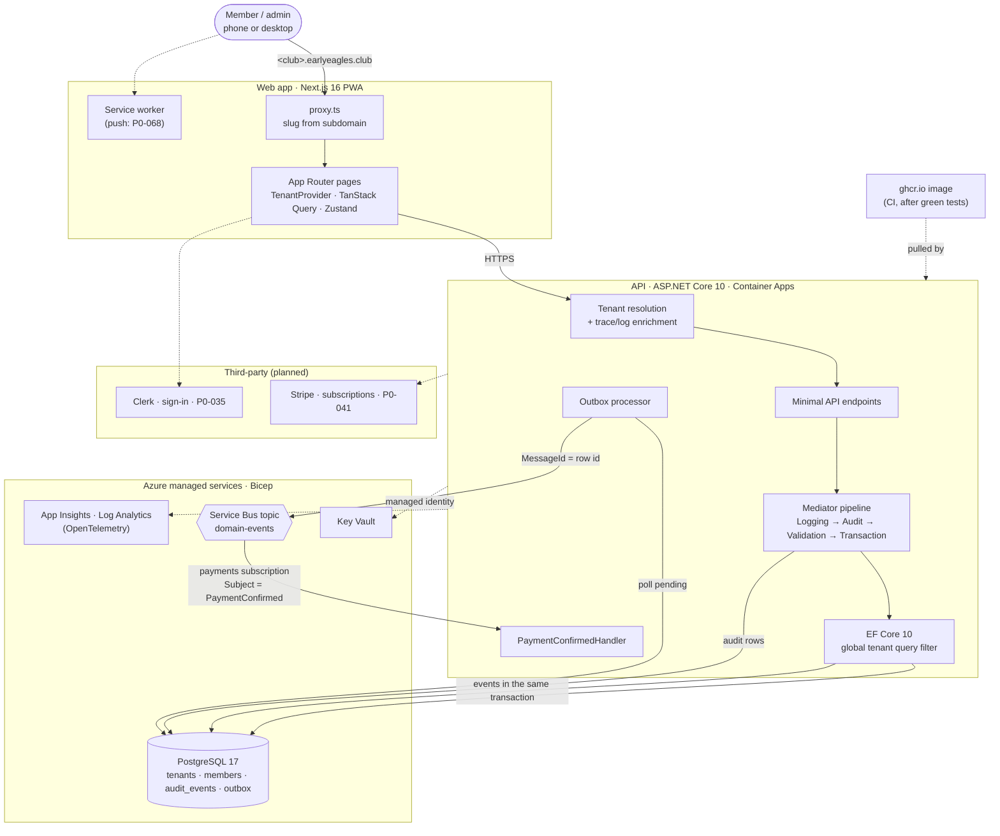

# Early Eagles Platform

Multi-tenant B2B SaaS platform for badminton clubs, owned and developed by **Skylights LLC**. The Early Eagles club is Tenant 0 — the first real customer used to validate every feature before it reaches paying tenants.

## Status

**Phase 0 — Enterprise Foundations, in progress.** Built so far: the multi-tenancy core (subdomain
resolution, EF Core global tenant filter, a Testcontainers isolation gate), append-only audit
logging, the transactional outbox with a Service Bus publisher and first consumer, Bicep for every
environment, and the web app shell (PWA, navigation, theming, cookie consent, tenant context).
Waiting on accounts: sign-in (Clerk), billing (Stripe), email, observability. See
[`PROGRESS.md`](./PROGRESS.md) for the live task-by-task status and percentage.

## Architecture

How a request flows today, and where the planned third-party services plug in. Every domain
table is tenant-scoped through the EF Core query filter. Every command is audited by the Mediator
pipeline. Domain events leave through the outbox, in the same database transaction as the change
that raised them.



Details: [ADR-0002](./docs/adr/0002-enterprise-saas-reframe.md) (the operative stack), the
[developer walkthrough](./docs/developer-walkthrough.md) (how each piece is built) and
[`infra/`](./infra/) (the Azure resources, in Bicep).

## Documents

Read these in order to get the full picture:

| # | Document | What it covers |
|---|---|---|
| 1 | [`project-scope.md`](./project-scope.md) | Problem · Solution · Features (per phase) |
| 2 | [`docs/adr/0002-enterprise-saas-reframe.md`](./docs/adr/0002-enterprise-saas-reframe.md) | **Operative architecture decision** — stack picks and rationale |
| 3 | [`Plan.md`](./Plan.md) | Architecture · stack · 9-phase roadmap · cost model |
| 4 | [`Implementation-Plan.md`](./Implementation-Plan.md) | ~250 numbered tasks across 9 phases |
| 5 | [`PROGRESS.md`](./PROGRESS.md) | Live status dashboard — what's done, in-flight, next |
| 6 | [`docs/developer-walkthrough.md`](./docs/developer-walkthrough.md) | **Build-from-zero guide** — recreate the project by hand, step by step |
| 7 | [`CLAUDE.md`](./CLAUDE.md) | Guidance for Claude Code (AI assistant) |
| 8 | [`docs/glossary.md`](./docs/glossary.md) | One meaning per term: tenant, member, session, RSVP, attendance, dues, … |
| 9 | [`docs/runbooks/`](./docs/runbooks/) | Deploy, migrate, roll back, respond to incidents |

Historical context and rejected alternatives live under [`docs/`](./docs/) — read only if you need to understand why a particular path was not chosen.

## Local development

### Quick start

**Prerequisites:** Node.js ≥ 22 with npm 11, the .NET 10 SDK, and Docker Desktop (running).
Nothing in the cloud is needed. Development runs entirely on your machine
([ADR-0009](./docs/adr/0009-local-dev-no-cloud-dev-environment.md)).

```pwsh
npm install                                   # web workspace dependencies
docker compose up -d                          # Postgres 17 on localhost:55432

# Point the API and EF tools at the container (PowerShell; use `export` in bash)
$env:ConnectionStrings__Postgres = "Host=localhost;Port=55432;Database=earlyeagles;Username=postgres;Password=postgres"

# dotnet-ef is a local tool whose manifest is in apps/api, so run it from there
cd apps/api
dotnet tool restore
dotnet ef database update --project src/EarlyEagles.Infrastructure --startup-project src/EarlyEagles.Infrastructure
cd ../..

dotnet run --project apps/api/src/EarlyEagles.Api --urls http://localhost:5080   # API
npm run dev                                                                      # web, http://localhost:3000
```

Check it: `curl http://localhost:5080/ready` returns `"Healthy"` with a `postgres` check, and
`http://localhost:3000` shows the dashboard. In non-Production the API serves its docs at
`http://localhost:5080/swagger`.

| Run the tests | Command |
|---|---|
| API unit tests | `dotnet test apps/api/tests/EarlyEagles.Tests.Unit` |
| API integration tests, including the tenant-isolation gate (Docker needed) | `dotnet test apps/api/tests/EarlyEagles.Tests.Integration` |
| Web lint / production build | `npm run lint` · `npm run build` |
| Web browser tests (installed Chrome, production build) | `npm run test:e2e` |

**Optional: the Service Bus emulator**, for messaging work. Copy `.env.example` to `.env`, set
`ACCEPT_EULA=Y` (your acceptance of the emulator's and SQL Server's licences) and an
`MSSQL_SA_PASSWORD`, then `docker compose --profile bus up -d`. See the
[walkthrough, §11](./docs/developer-walkthrough.md#11-running--verifying-locally) for the
connection string and the bus tests.

### Tenant subdomains

Every tenant is a subdomain (`<slug>.earlyeagles.club`); locally the same works under
`localhost`: **`http://<slug>.localhost:3000`**, e.g. `http://early-eagles.localhost:3000`.
The web app's `proxy.ts` and the API's tenant middleware both read the slug from the host.

- **Browsers need nothing.** Chrome, Edge and Firefox resolve every `*.localhost` name to your
  own machine by themselves, and so does `curl`.
- **Everything else on Windows needs a hosts entry.** The Windows resolver doesn't, so `ping`,
  .NET's `HttpClient` and other OS-level tools fail with *"No such host is known"*. Add one line
  per slug you use, from an elevated editor, to `C:\Windows\System32\drivers\etc\hosts`
  (macOS / Linux: `/etc/hosts`):

  ```text
  127.0.0.1  early-eagles.localhost
  127.0.0.1  alpha.localhost
  ```

A bare `localhost` has no tenant: pages render without one, and the API answers tenant-scoped
endpoints with `400 Tenant not resolved`.

## Contributing

Branch, commit and pull-request conventions are in [`CONTRIBUTING.md`](./CONTRIBUTING.md).
Everyone working on the project follows the [Code of Conduct](./CODE_OF_CONDUCT.md)
(Contributor Covenant 2.1).

## Contact

For licensing, partnership, or commercial inquiries: **moh.razib@gmail.com**

## License

**Proprietary.** Copyright © 2026 Skylights LLC. All rights reserved. See [`LICENSE`](./LICENSE).
